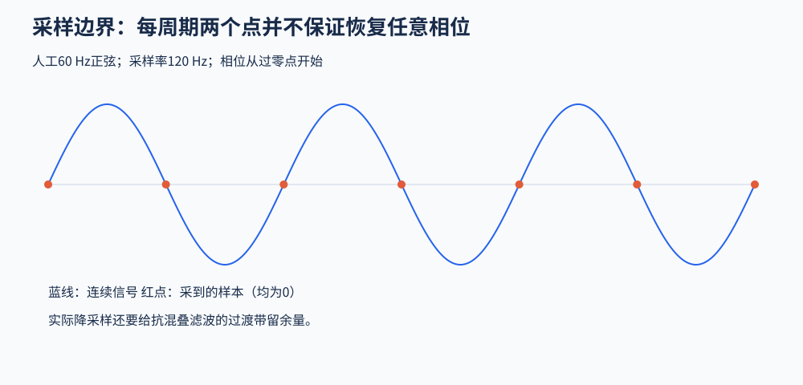

# 1．记录、采样和频谱

## 一个通道测到了什么

常规头皮电极记录的是相对于参考的电位差。简化写为：

\[
x_i(t)=V_i(t)-V_{ref}(t).
\]

头皮信号是多个脑内外电活动经过组织传导后的叠加，不能把某电极的波形直接等同于其正下方一个脑区的活动。接地或共模反馈用于电路工作及干扰控制，和定义电位比较基准的参考不是同一概念；具体接法应看放大器说明。

眼球运动、肌肉活动和心跳也是生理电信号，但在研究皮层活动时常作为伪迹。电极松动、桥接、放大器饱和和电源干扰则是另外的问题。一个方法能够处理其中一类，不代表能解决全部问题。

## 幅度、频率、相位与时间

正弦波可写成 `A sin(2πft + φ)`。`A` 是幅度，`f` 是每秒周期数，`φ` 决定相位。真实脑电通常不是单一正弦波，振幅和频率内容还会随时间改变。

同一个频率可同时含脑信号和干扰。例如，肌电并不只存在于某个唯一高频区间；眨眼也不只占一个固定低频点。按频率过滤，不能自动按来源分类。

## 采样率为什么限制分析

若每秒采样 `fs` 次，采样间隔为 `1/fs`。带限信号的无混叠采样要求采样率高于其最高频率的两倍；实际还要为抗混叠滤波的过渡带和所需时间精度留余量。

反例：`sin(2π·60·t)` 以每秒120点采样，若从过零点开始，则采样值为 `sin(πn)=0`。所以“恰好两倍一定足够”不成立。

图为人工正弦信号；用于说明有限采样点不能唯一识别任意连续频率，不是实际脑电记录。

混叠是高频成分在采样后表现为另一个低频成分。已经发生的混叠通常不能靠事后低通区分回来。因此采集时要考虑硬件抗混叠，降采样时也要先限制新奈奎斯特频率以上的能量。

## 量化与数值精度

模数转换器（Analog-to-Digital Converter，ADC）把连续电压映射到有限数字码。理想情况下，量化步长约为输入范围除以 `2^b`，其中 `b` 是位数；换算到电极输入端还要考虑增益和设备的编码约定。

相同范围下，步长越小意味着越细的数字分辨能力；扩大范围可以减少饱和风险，却可能使相同位数下的步长变大。增益、量化步长和浮点精度是不同概念。高位数不能弥补电极接触不良或已经饱和的采集数据。

## 波形与频谱各看什么

波形告诉你变化发生的时间、突变和持续时间；频谱反映不同频率上的能量分布，但通常丢失了这些活动在记录中何时发生的信息。看完频谱仍要返回波形定位异常。

功率谱密度（Power Spectral Density，PSD）描述单位频率上的功率，常用微伏平方每赫兹。它与傅里叶幅值、总功率、频带平均功率不是同一个量；比较时要统一单位、估计方法、窗长和归一化。

脑电常见的非周期背景可近似写为 `P(f) ∝ 1/f^χ`，这是幂律，不是指数函数。背景、谱峰和噪声会叠加。看到某频带功率增加，还需判断背景是否整体改变，不能直接认定该频带独立振荡增强。

较长观察窗常有利于区分邻近频率，但牺牲时间局部性。零填充能让频率坐标更密，不能创造原记录中不存在的独立信息。

## 自查

把数据从伏转换成微伏，波形数值放大 `10^6` 倍，功率数值放大 `10^12` 倍；实际生理信号没有因此增强。固定阈值若没随单位变化，就会失去原来的含义。

来源：[频谱教程](https://eeglab.org/tutorials/08_Plot_data/Plotting_Channel_Spectra_and_Maps.html)、[滤波与采样背景](https://mne.tools/stable/auto_tutorials/preprocessing/25_background_filtering.html)。

[下一章：事件与数据检查](02_Events_and_Data_Checks.md)
