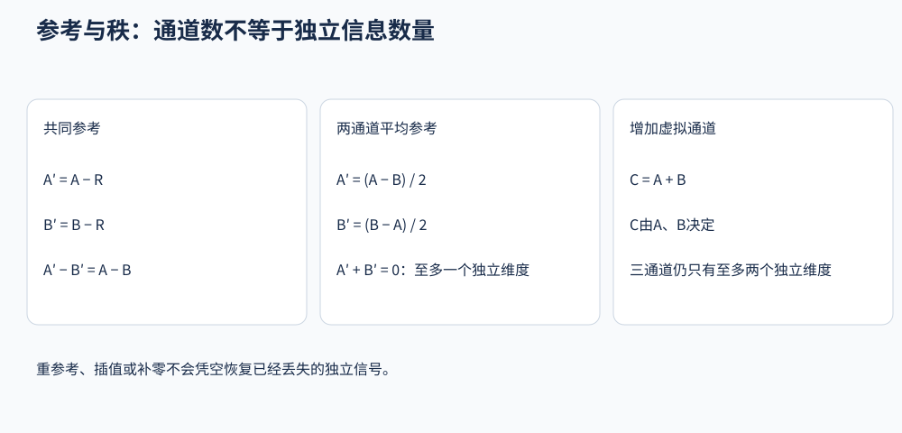

# 3．参考、插值与矩阵秩

## 重参考改变什么

若已有数据为 `x_i = V_i - V_old`，改成参考 `r(t)` 后，结果是 `x'_i = x_i - r(t)`。同一时刻所有参与通道减去相同的参考信号；参考本身也可能包含脑活动与噪声。

通道A和B的差在共同重参考下不变：`(x_A-r)-(x_B-r)=x_A-x_B`。但单个通道的振幅、波形、功率和某些连接指标可以变化。因此参考定义要记录，并与比较研究保持可解释的一致性。

常见选择包括单电极、双乳突平均、选定头皮电极的平均等。选择取决于实际记录、头皮覆盖、坏通道和分析目的，没有唯一普遍最佳参考。不要以让条件差异最大作为选择标准。

## 平均参考为什么可能传播噪声

平均参考取所选通道的算术平均。若一个通道含很大的异常，它会进入平均值，减到每个参与通道上。因此应先识别持续坏通道，或采用有明确依据的鲁棒参考流程；眼电、触发和未连接端口不应不加区分地进入头皮平均。

某些自动管线会在清理前后各算一次平均参考。代数上，若第一次只给所有保留通道减去共同信号，再按保留通道求平均，可以消去那个共同项。但中间清理可能依赖第一次参考，不能因此声称前面的噪声影响从未发生。

## 秩是什么

矩阵秩可理解为线性独立信号的数量。三个通道中若第三个始终等于前两个之和，它们只有两个独立维度。增加一个复制通道，虽然通道数增加，独立信息没有增加。

对 `N` 个通道减去它们自己的平均值后，各通道之和恒为零；这些通道不再全部线性独立，秩至多为 `N-1`。这是一种已知的线性约束，不等于数据“坏掉了”。后续分解应正确处理维度。

图为代数示例，不代表某种参考一定优于其他参考。

## 补零参考的前提

若采集时确实使用了某个共同物理参考，而导入时未把它作为通道保留，可以在合适的参考定义下将其相对于自身的零信号加回。把它纳入平均后，再移去该通道，与仅对现有头皮通道求平均，是不同的通道集合和参考定义。

该操作不能使本来秩亏的数据恢复原本丢失的信息。若先前已插值、桥接或去除了独立成分，不能凭补零保证满秩。记录方式特殊、已经重新参考或参考已在数据中时，也不能机械地再加一次零通道。

## 插值恢复的是估计

坏通道插值根据好通道的位置与信号，估计缺失位置的记录。球面样条是常见方法。固定电极位置和参数后，可把它写成 `X_interpolated = W X_good`：对信号值而言是线性组合，不能增加独立测量信息。

缺失通道越多、越集中，估计越依赖空间平滑假设；某个局部独有的活动不一定能恢复。结果看起来平滑，不代表估计准确。对传感器连接分析，应考虑插值引入的共享信息，并保留插值通道清单。

插值与 ICA 的先后存在不同工作流。若在分解前插值，要考虑有效秩与平均参考的定义；若在分解后补齐布局，要确认采用的分解和投影实现支持预期操作。初学者应先掌握一个明确、可检查的工作流，不把任意两套教程的步骤随意拼接。

## 如何估计有效秩

除了代数约束，数值容差和单位也影响计算。若将信号从微伏换成伏，协方差特征值缩小 `10^12` 倍；固定的 `10^-7` 阈值不能无条件沿用。查看奇异值谱，并结合已知的重参考、插值、桥接及去成分记录判断。

Huber 鲁棒均值按数据调整权重，不能简单视为固定线性参考矩阵。官方文档特别提示不宜在 ICA 前使用。对已有 ICA 解改变参考时，也不能只改通道数据而不考虑模型的一致性。

来源：[参考概念](https://eeglab.org/tutorials/ConceptsGuide/rereferencing_background.html)、[参考操作与Huber限制](https://eeglab.org/tutorials/05_Preprocess/rereferencing.html)、[坏通道插值背景](https://mne.tools/stable/auto_tutorials/preprocessing/15_handling_bad_channels.html)。

[下一章：滤波与降采样](04_Filtering_and_Resampling.md)
