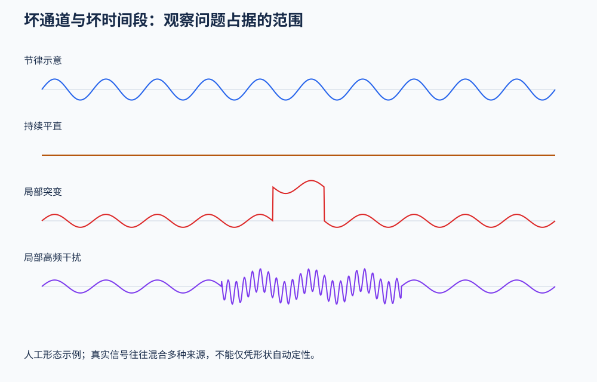

# 5．坏通道、坏时间段与自动清理

## 先辨认异常占据哪里

| 情况 | 先考虑的处理 | 理由 |
|---|---|---|
| 某一通道长时间平直、异常跳变或噪声突出 | 标记坏通道，决定排除或后续插值 | 整个时间范围都不可信 |
| 一个通道只有短时间异常 | 标记局部时间段，按目的删除或局部修复 | 不一定需要丢掉整条通道 |
| 多通道短时严重运动或饱和 | 标记坏段；比较删除与重构方案 | 广泛污染可能不符合稳定混合模型 |
| 重复、空间分布相对稳定的眨眼 | 可考虑独立成分分离或回归 | 可能利用稳定投影进行估计 |
| 相邻电极异常相似 | 检查导电膏桥接、参考及正常共同活动 | 高相关本身不能证明桥接 |

## 目视检查应怎样进行

先查看较长时间范围找到异常分布，再放大局部确认形态；滚动覆盖整段记录，避免只检查开头。调整显示尺度不改变数据，尺度太大或太小却会掩盖问题。

波形与频谱互相补充。平直信号、宽带高频噪声、窄工频峰、反复尖跳和异常低相关有不同含义。一个高波幅通道也可能包含正常脑活动，应结合空间分布、状态和辅助通道判断。

图为刻意简化的人工信号，不是伪迹分类器；真实记录经常包含多种混合。

检查并记录设备饱和：被放大器截顶的波形，其截断部分并未真实采到，不能宣称后续算法恢复了原始电压。

## 删除与重构的区别

删除承认这段没有足够可信的信息，但会减少试次数和时长。重构试图用剩余空间信息估计污染部分，可以保留时间轴，却会改变信号及其统计结构。保留更多采样点不等于保留更多独立信息。

任何方法都需要记录时间掩码与通道清单。删除后检查边界事件；重构后检查改变的位置、幅度以及研究指标是否受到影响。

## ASR 在解决什么问题

伪迹子空间重构（Artifact Subspace Reconstruction，ASR）通常使用较干净的数据估计校准结构，再在滑动窗口中找出偏离该结构的异常空间方向，并选择重构或拒绝相应数据。它利用跨通道协方差结构，而不只是逐点振幅阈值。

其阈值依赖校准、谱加权及实现中的统计估计；`20`不能理解为原始电压近似正态分布下的普通20个标准差。因此不能拿常规正态概率直接解释这个阈值，也不能把一个经验值当作所有实验的最优值。

校准数据若本身污染严重，标准可能不合适；任务中特别强但真实的活动，也可能被判异常。阈值放宽通常降低处理强度，但最后的窗口拒绝阶段可能让总删除比例以不同方式变化，所以要检查整个流程。

## 工具选项不应只看名字

`clean_rawdata` 可包含滤波、坏通道检测、突发异常处理和最终窗口拒绝。记录每个步骤是否启用。已经手动滤波时，避免不知情地再做一次；说“只修复不删段”时，还要检查其他窗口拒绝是否关闭。

官方离线教程与作者个人工作流对重构或删除有不同偏好。根据有效信息、事件完整性和研究指标比较，而不是认为某个偏好是唯一正确答案。

## 质量检查

- 分别统计丢弃通道、删除时长与重构影响量。
- 按实验条件检查保留的数据量，不只看全被试总比例。
- 对被改变最多的窗口及未处理窗口都抽查。
- 比较波形、频谱和目标指标，留意真实节律被过度压低。
- 对合理的相邻阈值做敏感性比较，不用显著性最大来选阈值。

来源：[坏通道检查](https://eeglab.org/tutorials/06_RejectArtifacts/Channel_rejection.html)、[坏段检查](https://eeglab.org/tutorials/06_RejectArtifacts/Scrolling_data.html)、[自动清理教程](https://eeglab.org/tutorials/06_RejectArtifacts/cleanrawdata.html)、[插件选项](https://eeglab.org/plugins/clean_rawdata/)。

[下一章：独立成分分析](06_ICA_and_Component_Review.md)
