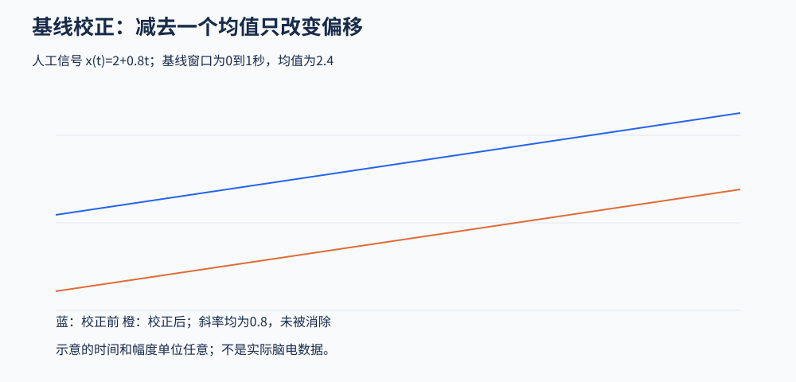

# 7．分段与基线：明确比较对象

## 分段为什么做

连续记录包含任务、间隔、休息和异常活动。围绕事件分段，是为了把重复事件放到共同的相对时间轴；固定窗口分段，则用于静息态等不需要事件锁定的分析。

窗口由目标时间范围、最低分析频率、估计方法、相邻事件和边缘缓冲决定。`[-1, 2]` 秒是一个三秒示例，不是所有低频分析的下限；刺激前200毫秒也不是所有研究的默认正确基线。

## 时间分辨率与低频窗口

理想化地，频率为 `f`、周期数为 `k` 的分析核，其周期长度约为 `k/f` 秒。3赫兹、3周期对应1秒。实际核长度还受窗函数、截断、软件定义和采样网格影响。

若分析核中心靠近片段边缘，所需数据可能超出范围。可以保留足够额外数据、采用合理填充，并排除受边缘影响的解释区间。受影响的宽度随参数改变，不能统一规定为半秒。

## 传统电位基线校正

对每个通道、每个试次，在基线区间 `B` 求均值，再从整条试次中减去它：

\[
x_{corrected}(t)=x(t)-\overline{x}_B.
\]

它改变的是垂直偏移。若 `x(t)=a+bt`，减去常数后斜率仍为 `b`，因此不能用它代替去趋势或高通处理。

图为人工线性漂移。两条线只相差一个常数，斜率相同。

## 基线隐含了哪些假设

你用基线定义“相对于什么变化”。若刺激前已经存在条件差异、期待活动或上一试次残留，减去均值会把这些差异带入刺激后。刺激前并不自动等于平静或零活动。

短窗口容易受瞬时节律相位和偶然噪声影响；过长窗口又可能包含其他事件或状态变化。因此需要根据实验时序判断，而不是简单越长越好。

如果基线污染了一个试次的均值，这个常数会被减到整个试次。检查基线段本身同样重要。回归式基线处理是可选扩展，可以把基线与时间、条件的关系纳入模型，但不免除窗口选择与模型检查。

## 时域基线与功率基线不是同一步

电位基线减去的是电压均值；功率基线则把某频率上的功率与参考窗口的功率比较。常见形式包括功率差、比值、百分比变化和分贝比值，不能互换解释。

例如功率分贝比为 `10 log10(P/P_base)`。功率翻倍约为3.01分贝；幅度翻倍、功率变成四倍时约为6.02分贝。这里的系数10来自功率比，不能与幅度比公式混淆。

## 试次处理顺序怎样决定

拟合 ICA 的数据通常避免短试次基线操作。事件分段和最终基线应围绕后续分析安排。清理前后都可能需要检查异常，但两次检查目的不同：前者避免极端坏数据影响模型，后者控制残余污染。

分段后核对：每种事件应有多少试次、实际保留多少、哪些因边界或文件首尾不足被丢弃、条件是否失衡。不要把程序正常返回等同于提取了全部目标事件。

来源：[分段教程](https://eeglab.org/tutorials/07_Extract_epochs/Extracting_Data_Epochs.html)、[回归式基线处理](https://mne.tools/stable/auto_tutorials/epochs/15_baseline_regression.html)。

[下一章：功率、时频与统计](08_Power_TimeFrequency_and_Inference.md)
