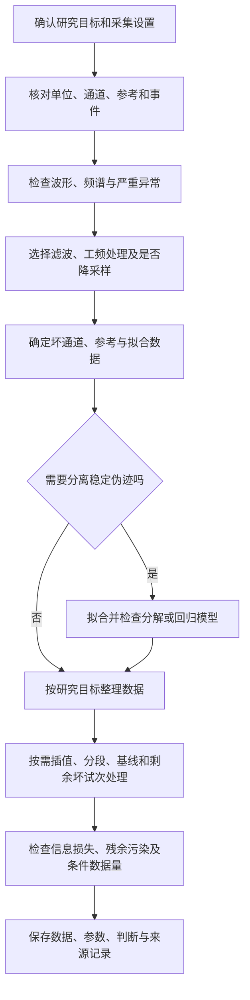

# 9．流程选择与质量检查

## 流程是一组有条件的决定

先写出研究目标：关注事件锁定电位、静息频谱、任务功率变化，还是其他指标；目标时间和频率范围是什么。再确定需要保留的信息和主要干扰。某步骤有用，不代表每份数据都需要执行。

这是一张决策地图，不是保证正确的单一算法顺序。例如，严重尖峰可能需要在滤波前标记；参考与插值时机也应与具体模型共同决定。

## 四类目标如何影响选择

| 目标 | 需要特别关注 | 不能直接照搬的设置 |
|---|---|---|
| 事件相关慢电位 | 低频保留、事件误差、基线及滤波时间扩散 | 为优化分解而采用的较强高通 |
| 静息频谱 | 状态、有效时长、窗长、参考及背景谱 | 与刺激锁定有关的基线窗口 |
| 任务时频功率 | 窗口周期、边缘、功率基线和试次数 | 所有频率统一固定的边缘缓冲 |
| 功能连接 | 共同混合、参考、时间滤波、模型与数据量 | 只因通道图更平滑就认为连接更可信 |

## 建议保存的四个检查点

1. **导入后**：原始缩放、位置、事件与记录质量。
2. **基础处理后**：滤波响应、频谱、重采样事件和通道选择。
3. **伪迹处理后**：处理前后同段对照、成分判断及剩余污染。
4. **分析前**：各条件有效试次或时长、最终参考、分段及基线定义。

保存这些中间状态可帮助定位问题。它们不要求每一步都额外生成大文件；合理保存必要副本、参数和掩码即可。

## 最低记录表

| 类别 | 至少记录 |
|---|---|
| 数据身份 | 被试、任务、采集文件、原始文件校验值或稳定标识 |
| 导入 | 格式、缩放、通道类型、采样率、记录参考、坐标 |
| 时间 | 触发编码、延迟校准、时间单位、删除后的事件映射 |
| 滤波/重采样 | 参数定义、过渡带、阶数或长度、相位、填充、目标采样率 |
| 坏数据 | 通道清单、时间掩码、试次索引、每项原因 |
| 分解 | 算法、版本、有效维度、随机种子、拟合数据与迁移方式 |
| 去成分 | 自动标签、人工决定、依据、保留/删除策略 |
| 最终分析 | 参考、插值清单、分段、基线、每条件有效数据量 |
| 软件 | 工具箱与插件版本、脚本提交标识、运行环境 |

## 如何发现过度清理

比较被改变最大的位置，同时抽查未改变位置。观察目标频段或目标响应是否系统性被压低，是否出现不合理的频谱凹口、边缘振铃或成分投影。

如果某组或某条件被删除更多数据，先查数据质量、行为和处理依据。为了让数量相同而随意删除好数据，也不是自动正确的修复。应选择适合估计偏差和统计问题的比较方法，并报告有效数据差异。

## 敏感性分析与防止选择性调参

预先列出少数有理由的候选设置，比较质量、信息保留与目标估计的稳定性。不要把让最终显著性最大作为选择依据。重要决策最好在不知道条件结果时进行，或使用独立数据决定。

一套流程能运行，只说明接口没有在该输入上报错。科学有效性仍需要与数据、假设和研究目标对应的证据。

来源：[官方教程总目录](https://eeglab.org/tutorials/)、[质量报告教程](https://mne.tools/stable/auto_tutorials/preprocessing/14_quality_control_report.html)。

[下一章：练习](10_Exercises.md)
